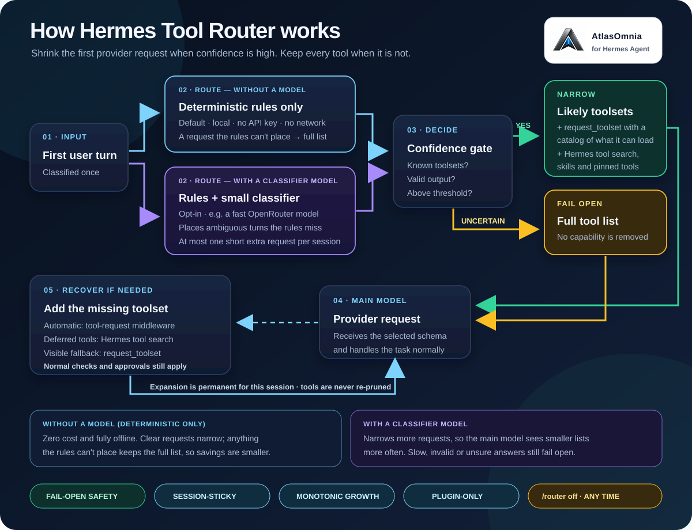

# Hermes Tool Router

Experimental standalone Hermes Agent plugin for reducing first-turn tool-schema overhead without repeatedly changing the tool prefix later in the conversation.

> Test on a separate Hermes profile first. Do not install an experimental router directly on a primary profile.

## How it works

<p align="center">
  
</p>

The router classifies only the first turn. High-confidence routes send a smaller tool schema to the main model; uncertainty keeps the full surface. If a pruned registered tool is needed later, Hermes adds its owning toolset without re-pruning the session. The narrowed session carries a short catalog of everything it can load, so the model can still answer "what can you do?" accurately, and `/router off` turns routing off without a model call.

## Recommended: add a fast OpenRouter classifier

The router works without an API key, but deterministic rules cannot recognize every request. When a request is ambiguous, the safe fallback is to send the entire tool catalog to the main model. That preserves capability but gives up much of the speed and token benefit.

> **For the best routing quality and responsiveness, connect a fast OpenRouter classifier.** For ambiguous first-turn requests, model classification is typically more accurate than deterministic-only routing: it can recognize intent that rules miss, select a smaller and more relevant tool surface, and help the main model choose the correct tools. Avoiding full-catalog fallbacks often reduces first-response latency and input-token cost.

OpenRouter is used only for the small first-turn classification request; it does not replace your main Hermes model. The router still fails open to the complete toolset if the classifier is unavailable, slow, malformed, or below the confidence threshold.

### OpenRouter quick setup

1. Create an [OpenRouter API key](https://openrouter.ai/settings/keys).
2. Add it to the environment used by Hermes:

   ```bash
   export OPENROUTER_API_KEY="your-openrouter-api-key"
   ```

3. Enable model-driven routing in `config.yaml`:

   ```yaml
   global:
     deterministic_rules_enabled: false
     confidence_threshold: 0.90
     router_hard_timeout_ms: 2000
     fail_open: true
     classifier:
       enabled: true
       provider: openrouter
       model: google/gemini-3.5-flash-lite
   ```

`google/gemini-3.5-flash-lite` is a verified low-latency example for this bounded JSON classification task. Model speed and behavior change over time, so benchmark the exact model and timeout before a production rollout. If you prefer rule-first routing, leave `deterministic_rules_enabled: true`; OpenRouter will then be used only when the deterministic policy returns no decision.

The classifier adds one short network request, so it is not a universal latency guarantee. The gain comes when better routing avoids sending a much larger tool schema to the main model.

## v0.2 design

- **First-turn routing:** deterministic intent classification narrows the live tool surface before the first provider request through stock Hermes hooks.
- **Session-sticky surface:** later turns reuse the initial surface instead of reclassifying and shrinking it.
- **Monotonic recovery:** requested toolsets are added permanently for the session.
- **Fail open:** uncertainty, invalid classifier output, missing confidence, timeout, registry mismatch, or unsupported runtime keeps the full tool surface. Protected definitions additionally remain bounded by the immutable host-admission envelope; invalid policy denies new additions rather than broadening.
- **Optional classifier:** external model routing is disabled by default. Deterministic misses fall back immediately with no network call.
- **Dynamic recovery:** `request_toolset` is generated from the live toolset registry and can request multiple toolsets. The registry is used for ordinary compatibility and discoverability only; protected definitions are recovered exclusively from the exact per-agent/session envelope.
- **Hermes tool search:** when Hermes defers tools behind its `tool_search`/`tool_describe`/`tool_call` bridge, narrowing keeps the bridge and keeps the bridge-only toolsets enabled, so deferred tools stay reachable; the catalog tells the model to search there. Protected capability stays inside the envelope: a fully deferred protected toolset is not re-enabled (unreachable while narrowed), and a `pre_tool_call` guard blocks any uncaptured tool of a protected toolset reached through `tool_call`. A toolset with some tools captured and others deferred is listed with its captured tools only; its deferred tools stay unreachable while narrowed (safe side).
- **Worker-thread hooks:** current Hermes runs `pre_llm_call` on a timeout worker thread. The agent is found by exact `session_id`: own stack, then the stored reference (re-validated), then other live threads (`agent` locals before `self`); two distinct matches are treated as ambiguous and nothing is bound. An explicit `agent` argument wins when its session matches.
- **Disabled means hands-off:** a disabled router never captures or restores a surface it did not narrow, so tools the host adds mid-session survive. If it narrowed earlier in the session and is then disabled, it restores the exact captured surface; the narrowed state (and the protected-tool guard) is cleared only when that restore succeeds, and a failed restore is retried on the next turn. Restores assign the captured `enabled_toolsets` exactly. Known limits: that one-time restore drops tools the host added while the session was narrowed; re-enabling later in the same session does not narrow again (the restored full surface is sticky).
- **Session end:** a narrowed session is restored at `on_session_end` and its routing state reset, so a reused agent object starts fresh. If the restore fails, the session keeps its admission, narrowed markers and agent reference: the protected-tool guard stays engaged, a narrowed surface is never recaptured as fresh authority, and a later session end or disabled turn retries the restore.
- **Skills stay reachable:** `skill_view` and `skills_list` are kept whenever the host captured them (not for a protected, unpinned skills toolset), because Hermes lists skills in the system prompt and tells the model to load them.
- **`request_toolset` results:** `reason` is the machine outcome (`READY`, `NO_AUTHORITY`, `UNRESOLVED_TOOL`, ...); the model's own justification is echoed as `request_reason`. Exact registered toolset names are matched before case folding.
- **Late hooks:** Hermes abandons (does not cancel) a timed-out hook. Every mutation a hook makes (route, fallback restore, admission binding, post-tool expansion, bookkeeping) is checked under a per-agent lock immediately before it is applied, and discarded if the session ended, the agent was reused for another session, the bound admission changed, or more than half of Hermes's normalized `plugins.hook_callback_timeout` (default 30 s, max 600 s; no limit when 0) has passed since the hook started. Slow work runs outside the lock, so session end never waits on a stalled hook.
- **Failed session-end restore:** in-flight hooks of that session are revoked, while the admission and guard stay in place and the restore is retried at the next session end or turn. If Hermes reuses the agent first, the router routes nothing for the new session and keeps guarding protected tools with the old policy. The quarantine is released only by restoring the old envelope, and that is attempted only while the agent still shows exactly the surface the router last committed (every definition and `enabled_toolsets`); any other change, including a partial addition, is treated as ambiguous and left untouched. A quarantine that does not clear logs one warning per session; the supported recovery is to discard that agent (a fresh agent is unaffected). Session-end teardown itself runs under the same fence and deadline, so an abandoned teardown never touches a reused agent. If a teardown expires before recording retirement, the still-bound admission of the old session is adopted as the quarantine on reuse, so the guard stays engaged.
- **Concurrent recovery:** expansions are prepared outside the lock against a surface revision and recomputed if another change landed first, so two recoveries never drop each other's tools.
- **Chinese requests:** clear Chinese action requests route deterministically; ambiguous or negated ones ("不要运行测试", "帮我看看这个") abstain and keep the full surface.
- **Guard limits:** the protected-tool guard resolves ownership through the Hermes registry; unregistered names (for example `connectors__*` connector batches, which are remote services rather than local toolsets) and registry lookup errors are allowed through.
- **Capability awareness:** after narrowing, the session's `request_toolset` carries a compact, deterministic capability catalog in its description: every toolset owning definitions in the admitted envelope (what the agent would have with the router off), each with a one-line description, plus an instruction to answer "what can you do?" from that catalog and load a toolset before use. When only part of a toolset was admitted, the entry names the admitted tools instead (`kanban (limited to: kanban_show)`) so a subset is not described as the whole toolset. Past 60 entries, names are still listed without descriptions; nothing is silently dropped. Size grows with the number of admitted toolsets: about 360 tokens for 18 toolsets and roughly 500 for 30, versus the full schema it replaces. It is an agent-local copy (the shared registry schema is unchanged), built once at the first route and kept byte-stable across sticky turns and recovery expansions. A fallback or disable that restores the exact captured surface also restores the captured `request_toolset` (or removes it), by design. Standalone questions about the assistant's own tools ("what can you do?", "list your tools") are classified as `capability_inquiry` and keep the small surface; anything that also carries a task keeps its normal routing. Yes/no questions such as "can you take screenshots?" are deliberately not special-cased (they are often polite requests); the catalog still answers them. If the host protects or pins `request_toolset`, its captured definition is left byte-exact and no catalog is added. Known limit: a toolset removed from the registry after capture can be listed but not loaded by name.

## Critical compatibility fact

First-turn token savings work through either an early Hermes surface hook or the stock `pre_llm_call` compatibility path. In current Hermes, `pre_llm_call` runs after the initial preflight estimate but before the actual provider request is assembled and before the loop's request-pressure estimate; mutating `agent.tools` there still reduces the transmitted tool schemas. The tradeoff is that the plugin must recover the live agent through compatibility logic unless Hermes passes it explicitly. Current Hermes runs `pre_llm_call` on a timeout worker thread; releases before #16 looked only at the calling thread's stack, found no agent there, and silently routed nothing. Upgrade if an installed copy shows no token savings.

Run diagnostics:

```bash
python diagnostics.py
```

Exit code `0` means a routing path is available before the provider request. Exit code `2` means the current runtime must not claim first-turn savings. The report separately states whether routing happens before the initial preflight estimate.

Automatic execution recovery uses Hermes's generic `tool_request` middleware. When the model emits a registry-known tool that was pruned, the middleware expands its owning toolset before normal validation and dispatch, then the original call continues through ordinary requirement checks and approvals. `request_toolset` remains the visible fallback.

### No Hermes core patch required

The tested implementation is plugin-only. Current Hermes already provides both extension points needed for provider-request reduction and automatic tool recovery. There is no router edit in Hermes core and no router entry in `apply-patches.sh`. An optional earlier hook could reduce internal preflight work, but it is not required for the measured request savings or successful tool execution.

See [docs/compatibility.md](docs/compatibility.md).

## Install on a test profile

```bash
hermes profile create router-test --clone
mkdir -p ~/.hermes/profiles/router-test/plugins
cp -R . ~/.hermes/profiles/router-test/plugins/hermes-token-router
```

Enable the plugin in the test profile, then set `profiles.router-test.enabled: true` in the plugin's `config.yaml`. Start a fresh session after configuration changes.

## Configuration

The safe default is disabled. Important v2 settings:

```yaml
global:
  enabled: false
  floor_toolsets: []
  deterministic_rules_enabled: true
  confidence_threshold: 0.90
  fail_open: true
  classifier:
    enabled: false
```

The router does not read routing_scope, expansion_mode, or shrink_mid_session; first-turn routing, session stickiness, and monotonic recovery are fixed runtime behavior in v0.2, not user-configurable modes.

The classifier remains opt-in because network latency, model behavior, and cost vary by deployment. For users prioritizing routing quality and fewer full-tool fallbacks, the OpenRouter setup above is recommended. When the classifier is disabled, unresolved deterministic requests safely keep all tools. Direct DeepSeek is the default hosted classifier when no provider is selected; OpenRouter is used only when explicitly configured. A local OpenAI-compatible endpoint can be configured as:

```yaml
classifier:
  enabled: true
  provider: custom
  model: router-local
  base_url: http://127.0.0.1:1234/v1
  api_key_env: null  # or an environment-variable name when authentication is required
```

## Turning routing on and off

`/router` switches routing for the running Hermes process without a model call and without changing config.yaml:

- `/router off` stops routing; a session the router narrowed gets its full tool list back on the next turn.
- `/router on` routes sessions that have not been routed yet, from their next turn. A session that was restored to the full list stays full until it ends.
- `/router reset` follows config.yaml again; `/router status` shows the effective state and each source (config.yaml, environment, `/router`).

Precedence: `HERMES_TOKEN_ROUTER_ENABLED=0` is a kill switch that `/router on` cannot override; otherwise `/router` beats config.yaml. Turning a config-disabled profile on with `/router on` uses that profile's configured settings (floors, bypass thresholds, classifier). In a messaging gateway, the command is subject to Hermes's slash-command access policy (`allow_admin_from` / `user_allowed_commands`); without that policy any user who can message the gateway can switch routing for every session it serves. A route already in progress when `/router off` arrives may still commit; the next turn restores it.

It works in the interactive CLI, the desktop app / TUI and messaging gateways (Hermes dispatches plugin slash commands there before the model). It does **not** work in one-shot `hermes -z "..."` runs, which send the text to the model. The switch is per process: in a gateway or desktop process it applies to every session that process serves, and a restart returns to config.yaml. For a permanent change edit `enabled` in config.yaml, set `HERMES_TOKEN_ROUTER_ENABLED=0` (forces off), or `hermes plugins disable hermes-token-router` (takes effect on restart).

## Development

```bash
python3 -m py_compile *.py tests/*.py benchmarks/*.py
python3 -m pytest
python3 benchmarks/run.py
python3 -m build
```

The committed 506-record corpus is a synthetic regression suite. It validates deterministic contracts; it does not replace live full-tools-versus-routed E2E testing.

## Current measured schema reduction

Against the live 39-tool Hermes registry, Hermes's own rough request estimator measured:

- `web`: 18,627 → 490 tokens (**97.37% reduction**)
- `file,terminal`: 18,627 → 3,207 tokens (**82.78% reduction**)
- `browser,web`: 18,627 → 3,364 tokens (**81.94% reduction**)

See [`docs/baselines/v0.2-rc1.md`](docs/baselines/v0.2-rc1.md) for commands and caveats. These are estimator results, not provider billing receipts.

## Live test-profile A/B validation

A paired full-tools-versus-routed evaluation using `openai/gpt-5.4-mini` produced:

- **10/10** safe-core cases passed;
- **100%** required-toolset recall;
- **100%** exact route accuracy;
- **100%** tool-call success and answer accuracy;
- **61.60%** average reduction in actual first-provider-request tokens across the no-tool, terminal, and web pairs;
- **94.239983** autoresearch score.

The run used stock Hermes hooks and no core patch. See [`docs/live-evaluation-v0.2-rc1.md`](docs/live-evaluation-v0.2-rc1.md) for the corpus, methodology, commands, raw token counts, and scope limitations.

## Current release gates

A stable release must demonstrate:

- at least 70% median first-turn schema-token reduction;
- at least 99.5% required-toolset recall and 100% critical-class recall;
- no unrecovered registered-tool failures in E2E testing;
- no task-success regression against the full-tool baseline;
- cache-stable serialized tool schemas after routing or the last expansion.

No quantitative production claim should be made until a versioned live validation report satisfies those gates.

## First-run onboarding

A first-run onboarding skill ships with this repo: [`skills/hermes-tool-router-onboarding/SKILL.md`](skills/hermes-tool-router-onboarding/SKILL.md). On a fresh profile's first interaction, the agent should load it to explain what the router does, offer the optional classifier API key exactly once, and walk through verification. No API key is required — the router is fully functional with deterministic rules and fail-open behavior out of the box; the classifier is strictly optional, opt-in, confidence-gated, and fail-open.

## Rev 6 host-admission and recovery contract

The standalone router preserves Hermes's final authorization role while enforcing a local no-broadening rule for protected definitions. A protected ceiling is the exact protected surface admitted by the host for one agent/session. A pinned floor is the exact admitted subset that must remain visible. Every pin is protected, but direct-orchestrator protected tools remain optional unless explicitly pinned. Protected definitions retain their complete captured OpenAI schemas and original envelope order; they are never manufactured from the global registry.

Trusted admission metadata is accepted only from the `hermes_token_router_admission` hook keyword and `_hermes_token_router_admission` agent attribute. Its exact version-1 shape is:

```json
{
  "schema_version": 1,
  "protected_toolsets": ["..."],
  "pinned_tool_names": ["..."]
}
```

`MISSING/MISSING` is a valid empty-policy compatibility case. Explicit `None`, booleans, malformed/unknown keys, empty or whitespace-padded identifiers, duplicates, and conflicting channels are invalid. Identifiers are not normalized. The adapter builds one immutable ordered owner snapshot from untouched input, evaluates worker identity once, composes the policy, and binds one result to the agent-attached `RouterState`. Same-session calls reuse that result by identity; disable/re-enable retains it and session end clears it. The process-global legacy state is never capability authority.

A worker is recognized only when both `HERMES_KANBAN_TASK` is nonempty and Hermes reports a dispatcher-owned worker. Complete owner mapping pins every incoming definition owned by the worker toolset. Predicate, registry, or owner uncertainty is `SAFE_NO_PRUNE`. Direct orchestrators can use only their host-admitted protected subset. Specialists, delegated children, inherited non-dispatcher contexts, and cron do not gain worker authority from inherited environment. A valid explicit pin for a present owner-unmapped definition protects that exact name; absent siblings remain denied. No exact four-name policy is hard-coded.

When untouched host provenance is unavailable, an attachable valid-policy call is `NO_AUTHORITY`: it preserves the current surface, denies protected additions, and permits append-only ordinary compatibility. The first ordinary append persists an immutable contamination marker before assignment; later same-session callers may append ordinary definitions but can never capture or promote an envelope. Invalid policy is transient `NO_AUTHORITY_INVALID_POLICY`: it preserves all fields, denies every new addition, performs no owner/definition lookup, creates no clean marker, and retains an existing marker. An unattachable agent is installed-only; capture-invalid input permits no expansion.

Route, visible request, `tool_request` middleware, post-tool recovery, and fallback share deterministic admitted/denied/installed results. Mixed ordinary/protected requests may report ordinary additions plus explicit protected denial. Total protected denial is side-effect-free. Candidate validation precedes coordinated setters, and any partial-assignment failure restores the exact pre-call schemas, order, state fields, counters, fallback/retry markers, and lifecycle-slot identity. Retry is allowed only after exact admitted installation. The empty-message path binds admission before returning and performs no classifier, available-toolset, definition-retrieval, recovery-control, retry, or recapture work. Local synthetic tests are contract evidence only, not live runtime acceptance or production rollout.

## License

MIT.
